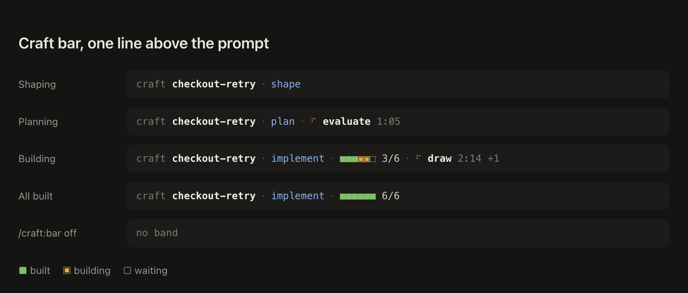

# Craft bar

One line above the prompt that says what [craft](https://github.com/juanwmedia/craft) is doing in this session, without asking Claude or spending a turn: the work's slug, its phase, its slices while implementing and the craft agent running now.



It is a mod, so it needs Claude Code 2.1.287 or later with mods turned on, and the craft plugin installed. `/craft-bar:bar off` hides it in every session and `/craft-bar:bar on` brings it back.

## Install

```bash
/plugin marketplace add juanwmedia/craft
/plugin install craft-bar@craft
```

## What it runs, reads and keeps

Everything stays on this machine. The mod, `hooks/register.ts`, runs `git config --get craft.detached` in the session's repository to learn whether craft's detached mode is on, lists `docs/craft/` and reads the work's `slices.md` to know the slug, the phase and the slices, and watches the `/craft:*` commands, the `Skill` tool calls that start a craft phase and the `craft:*` agents that spawn, only to draw the line. It changes nothing those calls do, runs no other program, and sends nothing anywhere. `/craft-bar:bar off` is the one thing it keeps, in the plugin's own store, so the bar stays hidden across sessions.

## Why a plugin of its own

The Claude plugin directory accepts mods only from Verified organizations, so craft ships without one and the bar lives here, installed from the same marketplace.

## Proof

A live session with craft loaded without its mod and this plugin beside it, driven through a pseudo terminal: `/craft-bar:bar on` answered by this mod ([bar-on](docs/try/bar-on.txt)), then `/craft:shape bar-try` drew `craft · shape` above the prompt ([shape-from-craft](docs/try/shape-from-craft.txt)).
